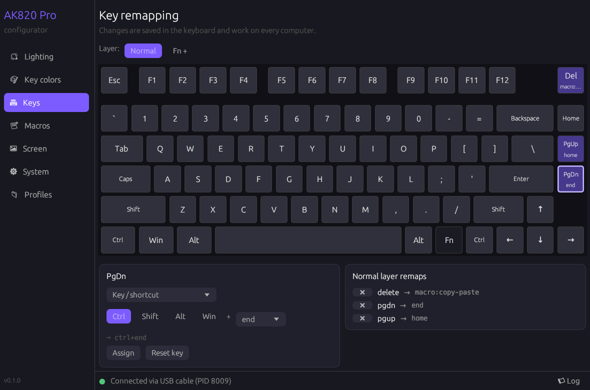
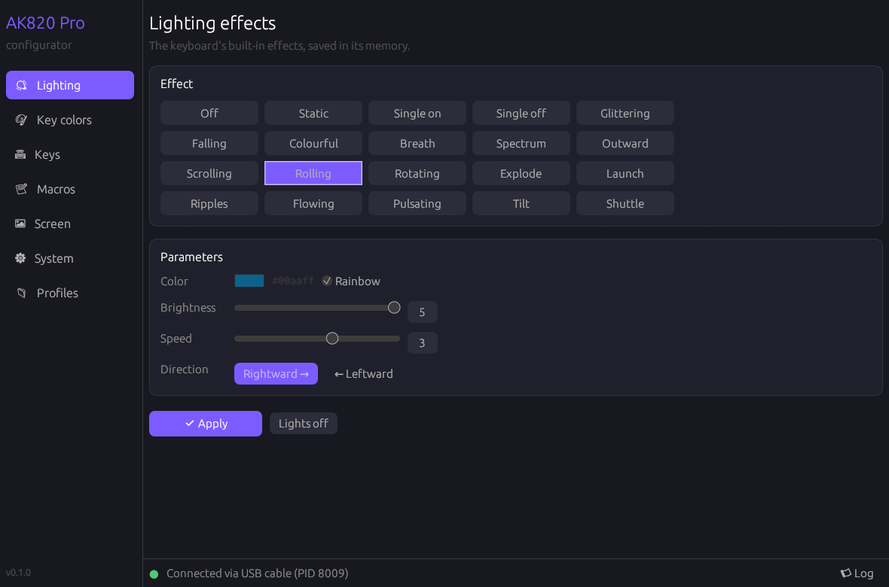
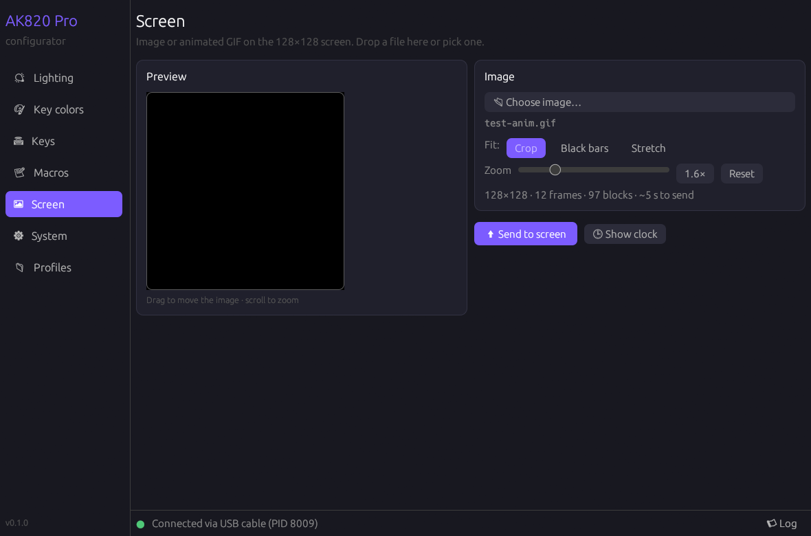
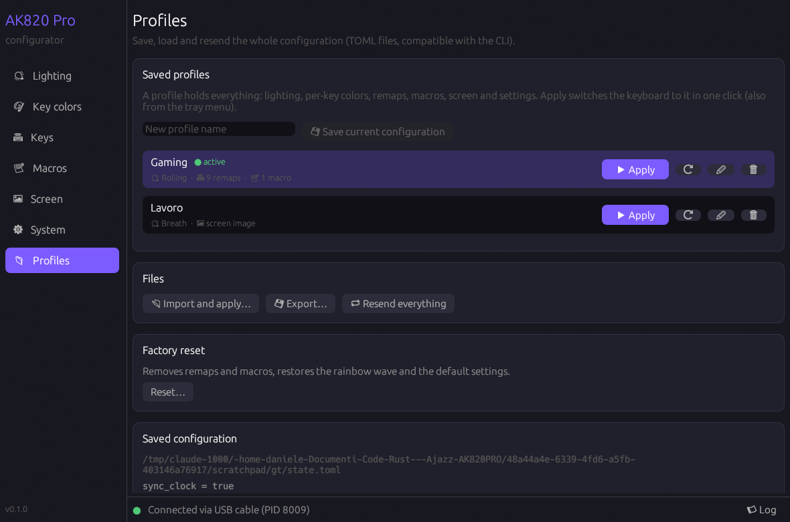
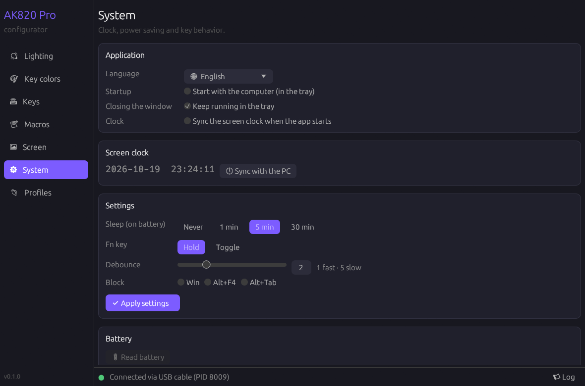

# ak820 — AJAZZ AK820 Pro configurator for Linux and Windows

**English** · [Italiano](README.it.md)

## Download

Ready-made binaries, no Rust needed: grab the latest version from the
[**Releases page**](https://github.com/deddroid/ak820-rs/releases/latest).

- **Windows**: download `ak820-…-windows-x86_64.zip`, extract it and run `ak820-gui.exe`.
- **Linux** (x86_64): download `ak820-…-linux-x86_64.tar.gz`, extract it and run
  `./install.sh --udev` inside the folder (installs into `~/.local` and adds the udev rule;
  see [Linux: permissions](#linux-permissions)).

A single Rust program to configure the AJAZZ AK820 Pro keyboard without the official software:

- **Lighting**: all 20 effects, color, rainbow, brightness, speed, direction (moving effects have two directions)
- **Per-key colors** (saved in the keyboard) and a live test animation
- **Key remapping** on the normal and Fn layers: keys, shortcuts, media, mouse, Multi-Key
- **Macros** stored in the keyboard (text, key combos, delays, clicks)
- **Screen** 128×128: still images and animated GIFs
- **Clock** of the screen synced with the computer
- **System settings**: sleep, Fn mode, debounce, blocking Win / Alt+F4 / Alt+Tab
- Works over the **USB cable** and, for lighting/keys/macros/clock/settings, also through the **2.4 GHz receiver**
- **TOML profiles**: the whole configuration in one file, applied with one command

Changes are saved in the keyboard itself: they work on any computer, with nothing running.

Available both as a **graphical app** (`ak820-gui`) and as a **command-line tool** (`ak820`);
they share the same saved configuration.



| Lighting | Screen |
|---|---|
|  |  |

| Profiles | System |
|---|---|
|  |  |

## Installation

To build from source you need [Rust](https://rustup.rs). On Linux, the easiest way:

```bash
./install.sh            # build and install into ~/.local (adds "AK820 Pro" to the app menu)
./install.sh --udev     # same, plus the udev rule for permissions (asks for your password)
./install.sh --uninstall
```

Or build by hand:

```bash
cargo build --release
```

This produces two executables in `target/release/`:

- `ak820-gui` (`ak820-gui.exe` on Windows): graphical app
- `ak820` (`ak820.exe`): command line

To build only the CLI, without GUI dependencies: `cargo build --release --no-default-features`.

### Linux: permissions

`hidraw` devices are only accessible to root by default. In the GUI, press **Concedi accesso**
("grant access") in the bottom bar: it asks for the administrator password and installs the
udev rule. Or from a terminal:

```bash
sudo cp udev/70-ajazz-ak820.rules /etc/udev/rules.d/ && sudo udevadm control --reload && sudo udevadm trigger
```

then unplug and replug the keyboard. `libudev` is required (present on every systemd distro).

### Windows

No driver needed: build with `cargo build --release` (MSVC toolchain) and run
`ak820-gui.exe` (the icon is embedded in the executable). Close the official AJAZZ software
if it is open.

## Graphical app

```bash
ak820-gui
```

Tabs: **Lighting** (lighting effects and parameters), **Key colors** (paint keys on the drawn
keyboard, right-click to clear), **Keys** (click a key and choose what it does, normal and Fn
layer), **Macros** (sequence editor), **Screen** (animated preview; in crop mode drag the image
to choose the visible part and scroll to zoom; drop an image or GIF), **System** (app settings,
clock, sleep, Fn, debounce, battery) and **Profiles** (saved profiles, import/export/resend,
factory reset). The bottom bar shows the connection status and the operation log.

**Saved profiles** hold the whole configuration: lighting or per-key colors, remaps, macros,
screen image (copied next to the profile) and system settings. **Apply** switches the keyboard
to a profile in one click, also from the tray menu.

**System → Application**:

- **Language**: English or Italian. By default it follows the system language
  (`LANG`/`LC_ALL`/`LC_MESSAGES` on Linux, the user locale on Windows);
  `AK820_GUI_LANG=en|it` forces one for a single run.
- **Start with the computer**: starts the app in the tray at login (XDG autostart on Linux,
  the `Run` registry key on Windows).
- **Keep running in the tray** when the window is closed: click the icon to reopen it, or use
  its menu to switch profile or quit. On GNOME the tray needs the AppIndicator extension.
- **Sync the screen clock** when the app starts.

These preferences are saved in `gui.toml`, in the same config folder as the state file. Only
one copy of the app runs at a time: launching it again shows the existing window.

## Command line

```bash
ak820 list                                   # HID interfaces found
ak820 keys                                   # key names, remap targets and effects

ak820 light rolling --rainbow -b 5 -s 3      # rainbow wave
ak820 light rolling -c 00aaff -d left        # wave moving left
ak820 light static -c ff6600 -b 4            # solid color
ak820 light off

ak820 colors --base 000020 w=red a=red s=red d=red   # per-key colors
ak820 demo --seconds 10                      # live animation (not saved)

ak820 clock                                  # sync the clock
ak820 screen cat.gif --fit crop              # image/GIF on the screen
ak820 screen photo.jpg --zoom 2 --x 0.3 --y 0.4   # crop: zoom 2×, centered at 30% / 40%

ak820 system --sleep 30m --fn-mode hold --response 2 --block-win off

ak820 remap capslock=ctrl pgdn=end           # remap
ak820 remap --fn left=prev right=next down=play
ak820 remap delete=text:hello                # macro typing "hello"
ak820 macro set copy "tap:ctrl+c" "delay:50" "tap:ctrl+v"
ak820 remap insert=macro:copy
ak820 remap pgdn=default                     # back to the original key
ak820 remap --reset                          # factory normal layer
ak820 remap                                  # show remaps

ak820 profile save gaming                    # save the current configuration as "gaming"
ak820 profile apply gaming                   # switch the keyboard to it
ak820 profile list                           # saved profiles (also: profile rm NAME)

ak820 apply examples/profile.toml            # apply a profile file
ak820 export my-profile.toml                 # save the current configuration
ak820 resend                                 # send everything again (e.g. after a reset)
ak820 reset --yes                            # factory settings
ak820 battery                                # battery (2.4G receiver only)
```

Directions: `right`/`left` for rolling, rotating, flowing and tilt; `down`/`up` for scrolling.
Other effects have no direction.

### Remap targets

| Target | Example |
|---|---|
| key | `b`, `f13`, `home`, `printscreen` |
| shortcut / modifier | `ctrl+shift+t`, `win+e`, `ctrl` |
| media | `play` `next` `prev` `stop` `mute` `vol+` `vol-` `bright+` `bright-` `calc` `mail` … |
| mouse | `mouse:left` `mouse:right` `mouse:middle` `wheel:up` `wheel:down` |
| several keys at once | `multi:a+s+d` |
| macro | `text:Hello!`, `macro:NAME` |
| original | `default` |

Macro steps: `text:…`, `tap:ctrl+c`, `down:KEY`, `up:KEY`, `delay:MS`,
`click:left`, `mouse-down:left`, `mouse-up:left`. Modes: `once`, `repeat` (with `--count`),
`toggle`, `hold`, `step`. Text uses the US layout (no accented letters).

### State

The keyboard cannot be read back, so `ak820` remembers the last configuration sent in
`~/.config/ak820/state.toml` (Windows: `%APPDATA%\ak820\state.toml`) and each command only
changes its own part. Override the path with `AK820_STATE`. `AK820_DEBUG=1` prints the
exchanged packets.

## Known limitations

- Bluetooth: the keyboard exposes no configuration interface.
- Per-key colors and screen: USB cable only.
- The configuration cannot be read from the keyboard (firmware limitation).
- Firmwares exposing `0xFF67` instead of `0xFF13` use a different protocol, not supported.

## Library

`src/lib.rs` exposes everything as a crate (`ak820::Keyboard`, `ak820::Profile`, …) for
anyone building another GUI or a daemon on top of it. The protocol is documented in
[docs/PROTOCOL.md](docs/PROTOCOL.md).

## Credits

Code written by [Claude](https://claude.com/claude-code) (Anthropic) together with
[deddroid](https://github.com/deddroid), who tested it on the keyboard.

Protocol consolidated from these projects (thank you!):

- [gha-projects/ak820-mac](https://github.com/gha-projects/ak820-mac) — analysis of `DeviceDriver.exe`: keys, macros, system, 2.4G receiver, checksum
- [hcristosm/ak820-linux](https://github.com/hcristosm/ak820-linux) — lighting, per-key colors, live mode, screen, clock on Linux
- [gohv/EPOMAKER-Ajazz-AK820-Pro](https://github.com/gohv/EPOMAKER-Ajazz-AK820-Pro) and [TaxMachine/ajazz-keyboard-software-linux](https://github.com/TaxMachine/ajazz-keyboard-software-linux) — first reverse engineering of lighting, sleep, clock, images
- [Beattrey/ajazz-ak820-config](https://github.com/Beattrey/ajazz-ak820-config), [gusleig/ajazz-ak820-pro-mac](https://github.com/gusleig/ajazz-ak820-pro-mac) — protocol notes
- [wsclx/ak820pro-modder](https://github.com/wsclx/ak820pro-modder) — alternative protocol of `0xFF67` firmwares
